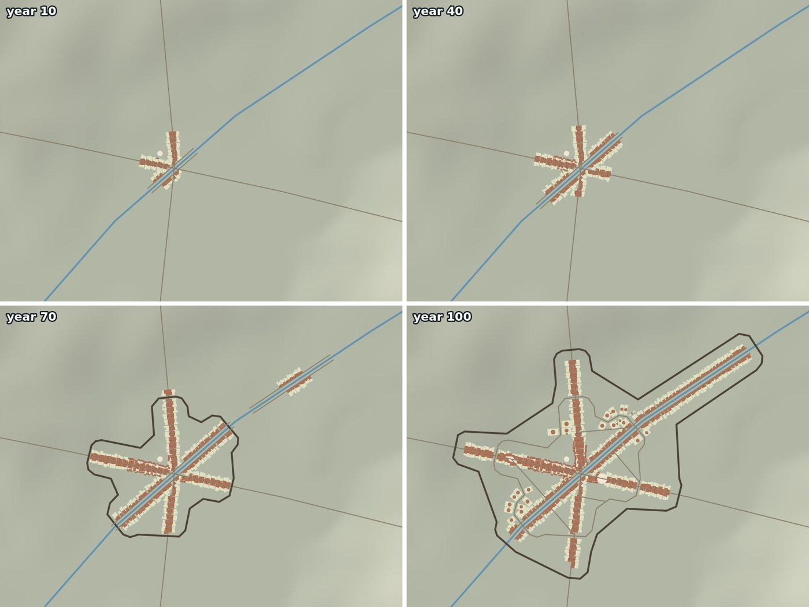

# go-simulator-urban




A [go-simulator](https://github.com/akrck02/go-simulator) plugin that grows pre-industrial cities year by year on real
relief: streets, burgage plots, densification, walls, squares and space syntax. Every rule comes
from a published model (Conzen 1960; Weber et al. 2009; Hillier and Iida 2005; Siksna 1997…); the
only rule of its own is the walls', because no published model simulates them.

```yaml
- rule: city
  name: my_town
  with: {include: town_scenario.yaml}
- {rule: densify, with: {city: my_town}}
- {rule: expand, with: {city: my_town}}
- {rule: walls, with: {city: my_town}}
- {rule: indicators, with: {city: my_town, years: [50, 100]}}
```

Documentation in [docs/](docs/README.md): [the model](docs/model.md), [the scenario](docs/scenario.md),
[outputs](docs/outputs.md), [testing](docs/testing.md) and the [rules reference](docs/rules.md).
Needs GEOS (`pkg-config geos`).
