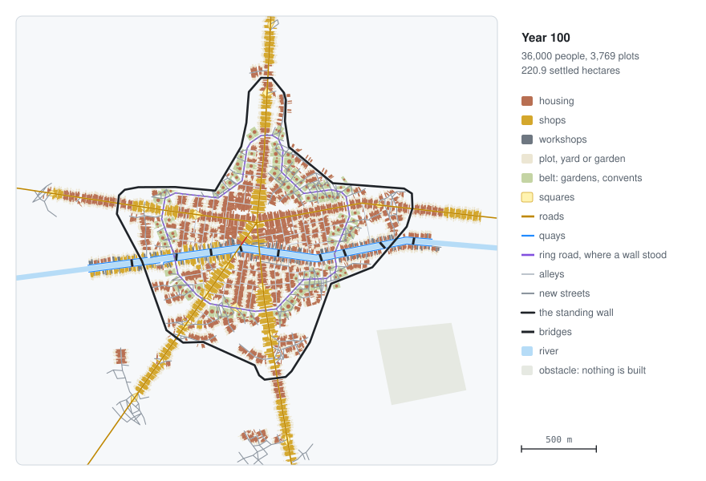
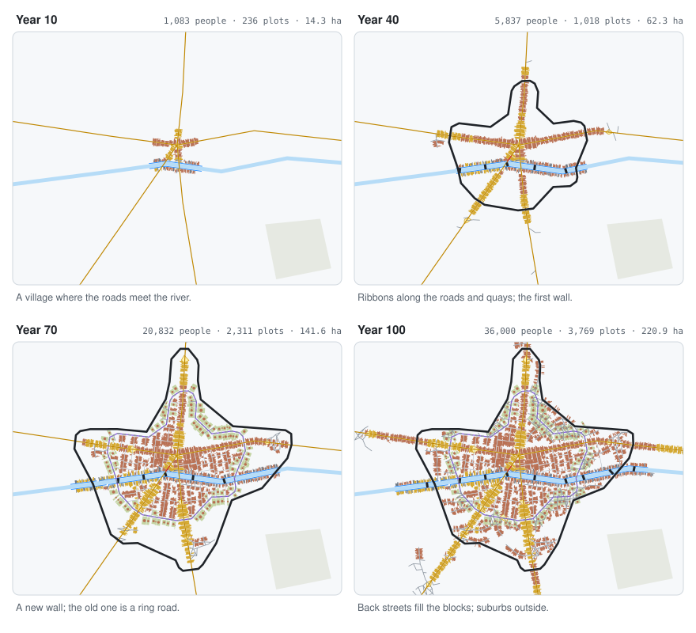

<div align="center">


# Go urban simulator

**Pre-industrial towns that grow year by year, as a plugin for [Go Simulator](https://github.com/akrck02/go-simulator).**
Streets, burgage plots, densification, walls, squares and space syntax, on real relief. Every rule
comes from a published model (Conzen 1960; Weber et al. 2009; Hillier and Iida 2005; Siksna 1997…);
the only rule of its own is the walls', because no published model simulates them.

[](go.mod)


</div>

## 🤖 AI disclosure

I write most of my code by hand, so I want to be clear about this project: **it was written by an
AI assistant (Claude, by Anthropic) under my direction.** I decided what to build and how it should
behave; the code, the tests and the documentation were written by the AI. Every commit made this
way carries a `Co-Authored-By: Claude` line (all of them).

**Status: pending thorough review.** The code compiles and its tests pass, but I have not yet
reviewed it line by line. Treat it as a working draft, not as code I vouch for.

---

<p align="center">
  
</p>

<p align="center"><sub>A made-up river town after 100 years, drawn from what the plugin itself answered.</sub></p>

## ✨ What it looks like

<p align="center">
  
</p>

<table>
<tr>
<th width="33%">Densify, then spread</th>
<th width="33%">Walls</th>
<th width="33%">Space syntax</th>
</tr>
<tr>
<td>Before the town spreads, its plots fill up: the house takes the back of the plot, then gains floors. New plots go along the most wanted free frontages; when none is left, new streets open.</td>
<td>The first wall goes up round what is built. When the suburbs outside hold too much, a new one goes up and the old one becomes a ring road with a belt of gardens and convents.</td>
<td>Every few years the street network is measured: the most chosen streets become main streets, the most central square the market, and plots on them shops.</td>
</tr>
</table>

<p align="center">
  
</p>

## 🚀 Quick start

Clone [Go Simulator](https://github.com/akrck02/go-simulator) and Go Renderer next to this
repository, and install GEOS (`brew install geos` or `sudo apt install libgeos-dev`). In a rules
file, the `city` rule names the town and the other rules find it by that name:

```yaml
- rule: city
  name: my_town
  with: {include: town_scenario.yaml}
- {rule: densify, with: {city: my_town}}
- {rule: expand, with: {city: my_town}}
- {rule: walls, with: {city: my_town}}
- {rule: indicators, with: {city: my_town, years: [50, 100]}}
```

```bash
cd ../go-simulator
go run ./cmd/simulate -rules <rules.yaml> -output results/
```

[More on getting started →](docs/3-getting-started.md)

## 🔍 How it works

<p align="center">
  
</p>

Go Simulator keeps the world and moves the clock, one year a step. The plugin keeps its cities, runs
the year's rules in the order of the rules file and answers with the entities that changed; it never
touches the renderer. [More on how it works →](docs/7-how-it-works.md)

## 📚 Documentation

| | |
|---|---|
| [The urban quest](docs/2-the-quest.md) | Grow a market town on a river for a century in 5 levels. |
| [Getting started](docs/3-getting-started.md) | The folders it needs, GEOS, a whole rules file, running it. |
| [The model](docs/5-the-model.md) | How a town grows every year, with the published models behind each rule, and pictures. |
| [The scenario](docs/4-writing-a-scenario.md) | Every key of the city's scenario, with its default, and the input features. |
| [Outputs](docs/6-what-it-writes.md) | The entities, properties, events and indicators the city publishes. |
| [Testing](docs/9-testing.md) | The six synthetic places, what is checked on every one, and profiling. |
| [How it works](docs/7-how-it-works.md) | How the plugin fits Go Simulator, and how the pictures were made. |
| [Rules reference](docs/8-rules-reference.md) | Every rule and parameter, generated from the plugin's own description. |
