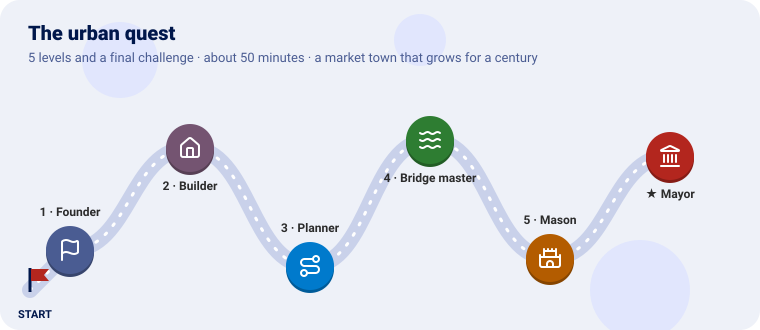
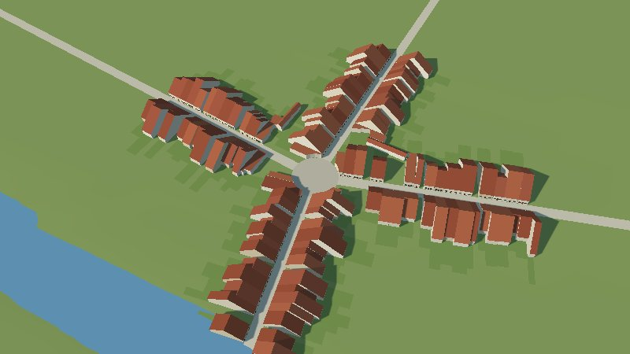
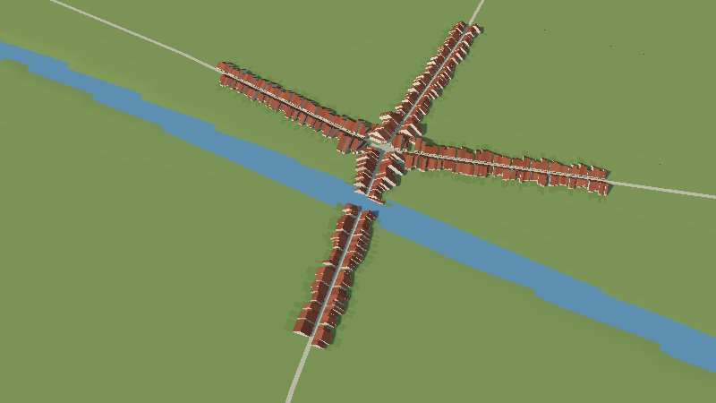
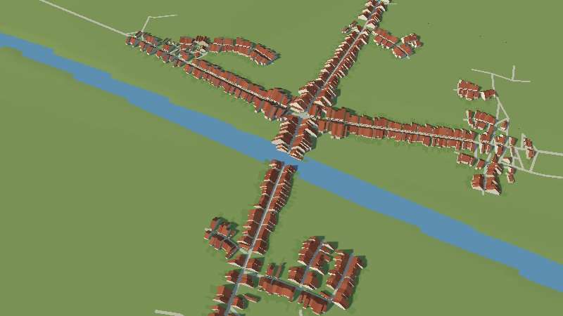
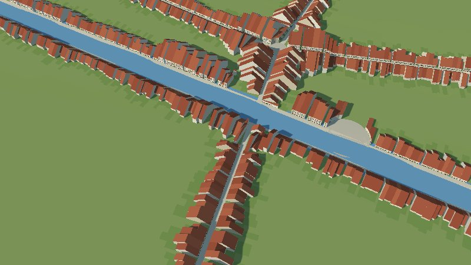
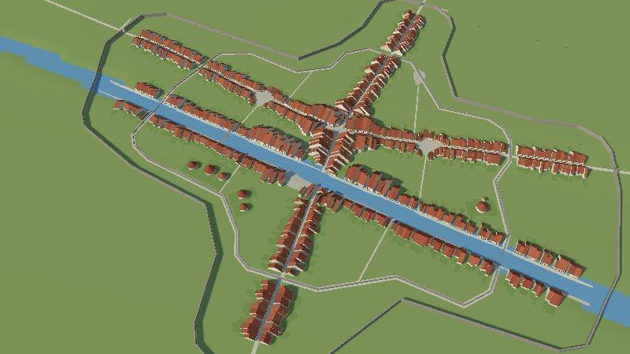
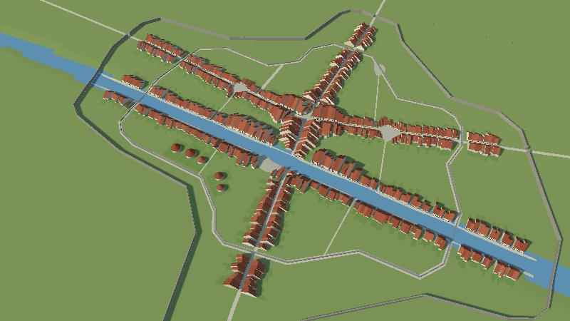
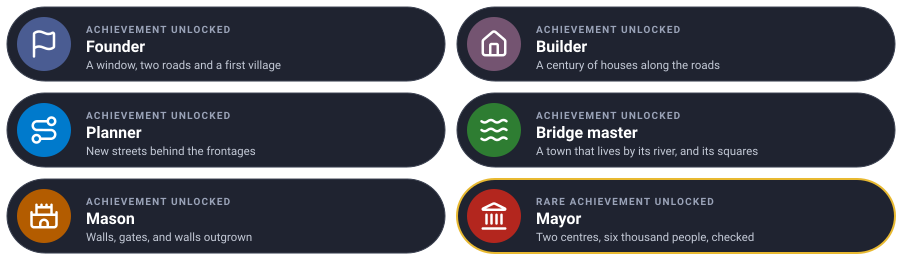

# The urban quest

Grow a market town on a river for a hundred years, one level at a time. Each level teaches one
piece of the urban plugin and ends with the town in 3D.



On a gentle plain crossed by a river and two old roads, a village of 300 people is founded where
the roads meet. It grows along them, opens streets of its own, takes to its river with quays,
bridges and squares, and builds a wall it later outgrows, until six thousand people live in it.

---

Every level has the same shape: **the idea** (explained with something from everyday life), **the
rules**, a **checkpoint** to know it works, and an optional **bonus**.

---

## Before you start

You need Go 1.25 and GEOS (`sudo apt install libgeos-dev`, `brew install geos`): the plugin cuts
plots and walls with it. Clone the projects side by side and make a folder for the quest:

```sh
git clone https://github.com/akrck02/go-renderer
git clone https://github.com/akrck02/go-scene-builder
git clone https://github.com/akrck02/go-simulator
git clone https://github.com/akrck02/go-simulator-terrain
git clone https://github.com/akrck02/go-simulator-urban
mkdir town && cd town
go mod init example.com/town
```

### The plain

`plain/main.go` writes the ground (4 × 4 km, a river valley, a hill to the north-west) in the
relief format the terrain plugin reads:

```go
// Command plain writes the ground a town grows on: a gentle plain, 4 × 4 km, lower along a river
// that crosses it from west to east, with a low hill in the north-west. relieve.json says the
// grid's size and place in kilometres; relieve.f32 holds a height in metres per cell.
package main

import (
	"encoding/binary"
	"encoding/json"
	"log"
	"math"
	"os"
)

func main() {
	const (
		columns, rows = 200, 200 // cells
		cell          = 0.02     // kilometres a side: 20 m
		west, north   = -2.0, 2.0
	)
	heights := make([]float32, 0, columns*rows)
	for row := range rows {
		for column := range columns {
			east := west + (float64(column)+0.5)*cell
			northing := north - (float64(row)+0.5)*cell
			heights = append(heights, float32(height(east, northing)))
		}
	}
	header, _ := json.Marshal(map[string]any{"columns": columns, "rows": rows, "cell": cell, "west": west, "north": north, "units": "km"})
	if err := os.WriteFile("relieve.json", header, 0o644); err != nil {
		log.Fatal(err)
	}
	file, err := os.Create("relieve.f32")
	if err != nil {
		log.Fatal(err)
	}
	defer file.Close()
	if err := binary.Write(file, binary.LittleEndian, heights); err != nil {
		log.Fatal(err)
	}
}

// height rises gently to the north, dips along the river and swells into a hill to the north-west.
func height(east, north float64) float64 {
	river := 0.1 * math.Sin(east*2) // the river's line, a little winding
	valley := -6 * math.Exp(-math.Pow((north-river)/0.25, 2))
	hill := 35 * math.Exp(-(math.Pow(east+1.2, 2)+math.Pow(north-1.2, 2))/0.4)
	return 40 + 4*north + valley + hill
}
```

```sh
go run ./plain
```

### Looking at the town

A run without a window writes the town as GeoJSON: buildings with their height, parcels, streets,
squares, walls, gates and the river. go-scene-builder turns that into a 3D scene with a **style**.
`town.yaml`:

```yaml
units: m
chunk: 0.5
environment: {sun: [220, 35]}
terrain: {color: "#8fa35a"}
relations:
  facing: {when: {kind: street}, reach: 15}
rules:
  - when: {kind: parcel}
    shape: {role: ground, lift: 0.1}
    color: "#7f9a4e"
  - when: {kind: street}
    shape: {role: ground, width: "width * 1000", lift: 0.3}
    color: "#d8cdb4"
  - when: {kind: square}
    shape: {role: ground, lift: 0.35}
    color: "#c9bfa8"
    material: {pattern: cobbles, scale: 0.4}
  - when: {kind: river}
    shape: {role: water, width: "width * 1000"}
  - when: {kind: bridge}
    shape: {role: line, follow: level, thickness: "width * 1000", height: 0.5}
    color: "#9c9486"
  - when: {kind: building}
    shape: {role: volume, height: "height * 1000"}
    walls: {color: ["#e9dfc9", "#efe4cf", "#e2d2b4", "#f1ead9"]}
    roof: {recipe: gable, pitch: 38, ridge: along_street, eaves: 0.3, color: ["#a4553a", "#9a4b33", "#b0613f"]}
    facade: {door: {color: "#5b3a26"}, windows: {shutters: ["#2f5d50", "#7a3b2e"]}}
  - when: {kind: wall}
    shape: {role: line, height: "height * 1000", thickness: 2.5}
    color: "#a59c8c"
    material: {pattern: masonry, scale: 0.6}
    battlements: {height: 1, width: 1, gap: 1}
    openings: {where: {kind: street, class: road}, width: 8}
    decorate: [{recipe: gate_towers, size: 6, height: 12}]
  - when: {kind: old_wall}
    shape: {role: line, height: 4, thickness: 2}
    color: "#9a9182"
```

and `look/main.go` (from the [terrain quest](https://github.com/akrck02/go-simulator-terrain/blob/main/docs/2-the-quest.md#looking-at-a-result)),
which tells the builder the snapshot's map is in kilometres with z to the south:

```go
// Command look turns a snapshot's entities into a map go-scene-builder reads: the snapshot writes
// [x, z] in kilometres, with z to the south, and the builder needs to be told so.
//
//	go run ./look "results/island 100.geojson" map.geojson
package main

import (
	"encoding/json"
	"log"
	"os"
)

func main() {
	content, err := os.ReadFile(os.Args[1])
	if err != nil {
		log.Fatal(err)
	}
	var collection map[string]any
	if err := json.Unmarshal(content, &collection); err != nil {
		log.Fatal(err)
	}
	properties, _ := collection["properties"].(map[string]any)
	if properties == nil {
		properties = map[string]any{}
	}
	properties["units"], properties["axes"] = "km", "east-south"
	collection["properties"] = properties
	out, _ := json.Marshal(collection)
	if err := os.WriteFile(os.Args[2], out, 0o644); err != nil {
		log.Fatal(err)
	}
}
```

After every run, for year 100:

```sh
go run ./look "results/town 100.geojson" map.geojson
go run ../go-scene-builder/cmd/build-scene -map map.geojson -relief "results/town 100 elevation.json" -style town.yaml -out town.glb
go run ../go-renderer/cmd/visor town.glb
```

The pictures were taken with `-zoom 0.25 -look-at 0,0` (and closer where it says).

---

## Level 1 · The Founder

| Mission | Pieces | Time |
|---|---|---|
| A village where two roads meet | `city`, the inputs, `nucleus`, `population`, `expand` | 10 min |

#### The idea

A town needs **somewhere to be and a reason to be there**. The plugin reads the first from a map of
inputs: the **window** it may grow in, the **roads** that already cross it, the **river**. The
second is a **population curve**: how many people live there each year. Every year the town finds
room for them, plot by plot, where they would most want to live: near the centre, on a street.

The `city` rule sets the town up and holds it; the other rules find it by its **instance name**.

#### Build it

`inputs.geojson`, in world kilometres `[x, z]`:

```json
{"type": "FeatureCollection", "features": [
 {"type": "Feature", "properties": {"role": "window"}, "geometry": {"type": "Polygon", "coordinates": [[[-1.5, -1.5], [1.5, -1.5], [1.5, 1.5], [-1.5, 1.5], [-1.5, -1.5]]]}},
 {"type": "Feature", "properties": {"role": "river", "width": 0.03}, "geometry": {"type": "LineString", "coordinates": [[-2, 0.07], [-1, -0.09], [0, 0], [1, 0.09], [2, -0.07]]}},
 {"type": "Feature", "properties": {"role": "road"}, "geometry": {"type": "LineString", "coordinates": [[-2, -0.4], [-0.6, -0.25], [0, -0.15], [0.7, -0.3], [2, -0.2]]}},
 {"type": "Feature", "properties": {"role": "road"}, "geometry": {"type": "LineString", "coordinates": [[0.1, -2], [0.05, -0.6], [0, -0.15], [0.05, 0.4], [0.3, 2]]}}
]}
```

`rules.yaml`: the terrain plugin puts the plain in the world, and the urban plugin grows on it:

```yaml
plugins:
  - {name: terrain, command: [go, run, .], directory: ../go-simulator-terrain}
  - {name: urban, command: [go, run, .], directory: ../go-simulator-urban}

stages:
  - name: town
    clock: {unit: year, from: -1, to: 10, step: 1}
    snapshots: [10]
    rules:
      - rule: relief
        with: {path: relieve.json, origin: [0, 0]}
      - rule: city
        name: market_town
        with:
          features: inputs.geojson
          seed: 7
          nucleus: [0, -0.15]
          centres: [{at: [0, -0.15], weight: 1}]
          population: {model: logistic, from_year: 0, from: 300, to_year: 100, to: 6000, ceiling: 7000}
          max_floors: [{before: 50, floors: 2}, {floors: 3}]
      - {rule: expand, with: {city: market_town}}
      - {rule: indicators, with: {city: market_town, years: [10]}}
```

`logistic` growth starts slowly, speeds up and levels off under a `ceiling`.

```sh
go run ../go-simulator/cmd/simulate -rules rules.yaml -output results/
```

#### Checkpoint

At year 10, a round little square where the roads meet, and houses along the roads near it, their
doors on the street.




Learn more: [Writing a scenario](4-writing-a-scenario.md) · [The model](5-the-model.md)

---

## Level 2 · The Builder

| Mission | Pieces | Time |
|---|---|---|
| A century of growth | `densify`, the clock, indicators | 6 min |

#### The idea

A town grows two ways: **outwards**, new houses on new plots (`expand`), and **inwards**, houses
rebuilt taller and closer as plots fill (`densify`), like a **bookshelf** that first gets new
shelves, then books squeezed in. `max_floors` says how tall houses may be in each period.

#### Build it

Run the whole century, with both rules:

```yaml
    clock: {unit: year, from: -1, to: 100, step: 1}
    snapshots: [10, 50, 100]
    rules:
      - … relief and city as before …
      - {rule: densify, with: {city: market_town}}
      - {rule: expand, with: {city: market_town}}
      - {rule: indicators, with: {city: market_town, years: [10, 50, 100]}}
```

#### Checkpoint

By year 50 the town has stretched along all four roads, a **street village**, one house deep. In
`results/events.jsonl`, the `indicators` of year 100 count 6,000 inhabitants on about 42 hectares.




---

## Level 3 · The Planner

| Mission | Pieces | Time |
|---|---|---|
| Streets of its own, behind the frontages | `open_streets_below`, pruning, splitting | 6 min |

#### The idea

When the road frontages are taken, a town either keeps stretching along them, or **opens new
streets** behind them, like a **tree** growing branches. `open_streets_below` says when: a town
opens a street before building on frontages less wanted than this (0.3 makes street villages,
0.5–0.7 compact towns). Streets that stay empty are pruned; blocks that grow too large are split.

#### Build it

In the city's `with`: `open_streets_below: 0.6`. And two rules that tidy the street network every
five years:

```yaml
      - {rule: prune_empty_streets, with: {city: market_town}, every: 5}
      - {rule: split_large_blocks, with: {city: market_town}, every: 5}
```

#### Checkpoint

New lanes branch off the roads, with blocks of houses between them: a town, not a cross.




---

## Level 4 · The Bridge master

| Mission | Pieces | Time |
|---|---|---|
| A town that lives by its river, with squares | `river`, `squares`, `space_syntax` | 8 min |

#### The idea

A river is a **street of water**: plots facing it are wanted, quays line it, bridges cross it where
people need to. And where many paths cross, people stop: a **square** opens. To know where paths
cross most, the town measures **space syntax**: how often each street lies on the shortest way
between two places.

#### Build it

In the city's `with`:

```yaml
          river: {reach: 0.25}
          squares: {per_inhabitants: 1500}
```

and two rules:

```yaml
      - {rule: space_syntax, with: {city: market_town, samples: 200}, every: 5}
      - {rule: squares, with: {city: market_town}, every: 5}
```

#### Checkpoint

Close up (`-zoom 0.12 -look-at 0,0.05`): rows of houses along both banks where the road crosses, and
a square by the water. The snapshot now counts two squares.




---

## Level 5 · The Mason

| Mission | Pieces | Time |
|---|---|---|
| A wall, gates, and a wall outgrown | `first_wall`, the `walls` rule | 6 min |

#### The idea

A town walls itself when it has **something to protect**: here, once 2,500 people live in it. The
wall goes round the built town, with **gates** where roads leave. When the town spills past it, a
new, wider wall is built, and the old one stays as `old_wall`, like **rings in a tree trunk**.

#### Build it

In the city's `with`: `first_wall: {population: 2500}`, and the rule, before the tidying ones:

```yaml
      - {rule: walls, with: {city: market_town}}
```

The style already draws `wall` with battlements and towers at the gates, and `old_wall` lower.

#### Checkpoint

A wide wall round the town with towers where the roads go through, and the line of the first,
smaller wall inside it. The snapshot counts `wall`, `old_wall` and four `gate`s.




---

## Final challenge · Mayor

Give the town a **second centre** north of the river, which starts to draw people in year 40 and
takes thirty years to grow; and **check** the century: about six thousand people at the end
(±10 %), and a wall.

> **Hint:** `centres` takes several, each with a `weight`, `grows_from` and `grows_for`.
> Objectives go in the stage. Careful with commas in names: in `{…}`, a comma ends the value.

Try it on your own first, then compare with the solution.



<details>
<summary>🔓 Show the solution</summary>

<pre><code>          centres: [{at: [0, -0.15], weight: 1}, {at: [0.1, 0.6], weight: 0.6, grows_from: 40, grows_for: 30}]</code></pre>

<pre><code>    objectives:
      - {name: about six thousand people, at: 100, event: indicators, value: inhabitants, near: 6000, tolerance: 0.1}
      - {name: walled, at: 100, count: {kind: wall}}</code></pre>

The run ends with `objectives: 2 of 2 reached`.

</details>


---

## Well done



You founded a town, let it grow for a century by rules of where people want to live, and checked
it came out as planned.

### Ideas to keep going

| Idea | Difficulty | Hint |
|---|---|---|
| Taller in the core | ⭐ | `density` and `rare_floors` ([scenario](4-writing-a-scenario.md)) |
| Curvier streets | ⭐ | `organic: {wander_degrees: 20}` |
| Watch it grow live | ⭐⭐ | `go-simulator/cmd/simulator` with a `scene_style` (go-simulator's [rules files](https://github.com/akrck02/go-simulator/blob/main/docs/4-guides/1-rules-files.md#scene_style)) |
| The town on an island of your own | ⭐⭐⭐ | The [terrain](https://github.com/akrck02/go-simulator-terrain/blob/main/docs/2-the-quest.md) and [flora](https://github.com/akrck02/go-simulator-flora/blob/main/docs/2-the-quest.md) quests, with `tree_nodes` to clear the forest |

## Troubleshooting

| You see | Why, and what to do |
|---|---|
| `city: at least one growth centre is needed` | Add `centres: [{at: [x, z], weight: 1}]` |
| `pkg-config: geos not found` | Install GEOS: `libgeos-dev` or `geos` |
| An objective's name is cut short | A comma inside `{…}` ends the value: write the number in words, or quote the name |
| The town does not grow | The population curve starts after the clock, or the window is all obstacles |
| The town is mirrored in the viewer | The map was not run through `look` |

---

[← All the documentation](1-overview.md)
