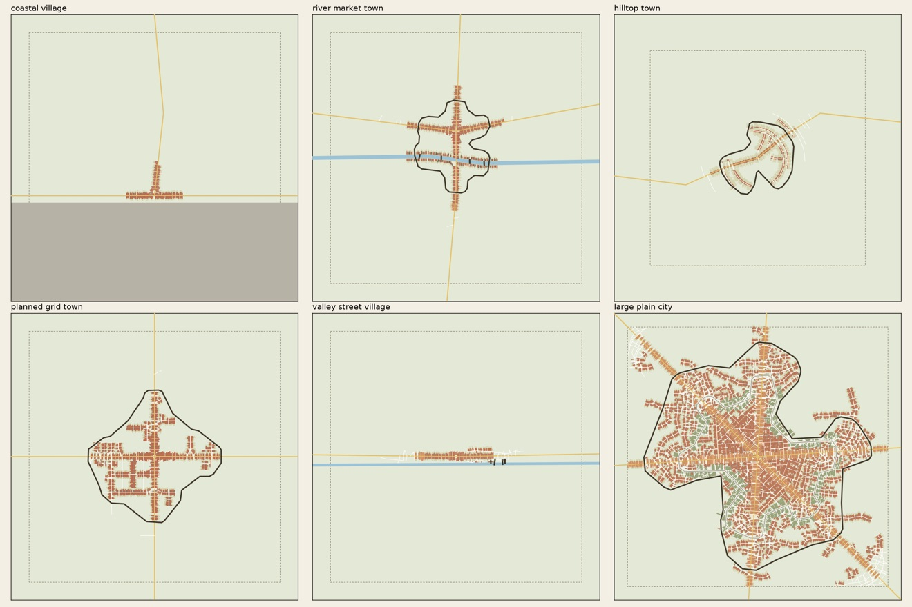

# 🧪 Testing

## Different kinds of places

The plugin is tested on six synthetic places that grow into very different towns, and on every one
it checks what must hold anywhere: nothing built in water or on obstacles, no plots on top of each
other, nothing outside the window, the floor space the people need and a settled area close to
what towns of that size covered.

| Place | Settings | Result |
|---|---|---|
| Coastal village (1,200) | sea as obstacle, `open_streets_below: 0.3` | a ribbon along the shore |
| River market town (6,000) | river, wall at 3,000, `0.7` | compact core with back streets, across the bridge |
| Hilltop town (2,500) | hill 140 m high, square houses | rings along the contour lines |
| Planned grid town (8,000) | grid zone from the start, `0.7` | regular blocks of about 80 m |
| Valley street village (1,500) | steep valley sides, river | a street village between the slopes |
| Large plain city (80,000) | three roads, two centres, `0.5` | dense core, two walls, ring road and belt, suburbs |

```bash
URBAN_PLACES_OUTPUT=places go test -run DifferentKinds -v ./urban     # -short skips the large city
uv run --no-project --with matplotlib python tools/view_snapshot.py places.png places/*/
```

<p align="center">
  
</p>

The picture is what those two commands draw (the window dashed, roads in yellow, rivers blue,
obstacles grey, houses by use, walls black), made smaller for this page.

## Everything else

```bash
go test ./...
URBAN_RULES=path/to/rules.yaml URBAN_UNTIL=20 go test -run RulesFile -cpuprofile cpu.out ./urban
```

The second command runs a rules file inside the test process until a year, with a CPU profile for
`go tool pprof`. Other tests cover the street network, frontages, densification, walls rising in
phases or by the calendar, colours from the scenario, and a town grown on the world's elevation
field matching the same town grown on the relief file, entity by entity.
