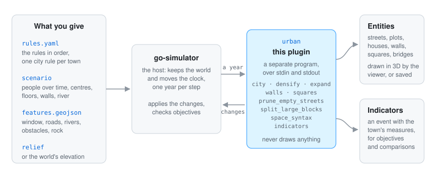

# 🔍 How it works

## How the plugin fits go-simulator

  

go-simulator is the host. It reads the rules file, keeps the world (its entities, fields and
events) and moves the clock. The urban plugin is a separate program the host starts; they talk over
standard input and output (go-simulator's [protocol](https://github.com/akrck02/go-simulator/blob/main/docs/protocol.md)).
`main.go` only serves the plugin; everything else is in the `urban` package.

- At the start the plugin **describes** itself: its nine rules, their parameters, what each one
  reads and what it writes. That description is also where the [rules reference](rules.md) comes from.
- The `city` rule reads the world's `elevation` field when the scenario gives no relief file. The
  other rules read nothing from other plugins: they work on the city the `city` rule set up.
- The rules write the city's entities (`street`, `parcel`, `building`, `wall`, `old_wall`,
  `square`, `bridge`, `river`) and the `indicators` event; see [outputs](outputs.md).

A plugin never touches the renderer: it reads its copy of the world and answers with changes
(go-simulator's [writing plugins](https://github.com/akrck02/go-simulator/blob/main/docs/writing-plugins.md)).
Shapes are in world units on the ground plane (x, z, in kilometres) and fields in physical units, as
go-simulator's [vocabulary](https://github.com/akrck02/go-simulator/blob/main/docs/vocabulary.md) lists.

## What travels each year

The town's rules belong on a stepped clock in years. Every step the host gives each rule of the
stage the year, in the order of the rules file; a rule with `every: N` runs only when N years
have passed since its last run. The rules change the city the plugin keeps in memory, and after the
host's request the plugin publishes the city once: only the entities that changed since the last
time travel back (a new plot, a house with one more floor, a street that became a main street, a
new wall). Thousands of plots stay cheap that way, and each kind travels as one batch to draw.

The same scenario and `seed` grow the same town: a test grows a place twice and compares the two
([testing](testing.md)).

## How the pictures were made

The pictures of the river town (the town at the top of the README, the four years, the chart, the
walls, the streets, the floors and the river) were drawn from the plugin's own answers. A small
throwaway program, kept outside the repository, ran the real plugin inside a go-simulator host with
the rules file in [getting started](getting-started.md#a-whole-rules-file), stepped it year by
year to year 100, kept every year's `indicators` event and, every five years, the city's entities,
and drew them from above.

They are SVG drawings with their own light and dark colours, not screenshots of the viewer: the
look of a town in 3D comes from the scene and its style, not from this plugin. The six test places
in [testing](testing.md) were drawn with the repository's own `tools/view_snapshot.py`, from what
the places test saves with `URBAN_PLACES_OUTPUT`. The diagrams (how it fits, a year, a plot over
the years) were drawn by hand in the same style. The two pictures of the example island at the top
of [the model](model.md) were in the repository before these pages, and show a different made-up town.
