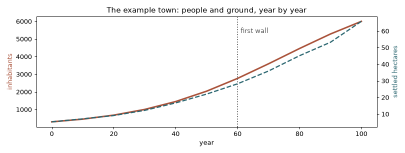

# The urban growth model

Old towns grew in a recognisable way. People arrived; first they built along the roads; the houses
filled their plots, back and then up; when there was no room left, new streets opened; busy
crossings became squares; and one day the town was big and rich enough to build a wall. The urban
plugin follows that story year by year, with rules taken from studies of real historic towns.




*The example town: from 300 to 6,000 people in 100 years. It follows the roads and the river, and
raises its first wall at year 60.*

Every rule comes from a published model; the only rule of its own is the walls', because no
published model simulates them. It knows nothing about any particular city: the
[scenario](scenario.md) says where, how many people and when.

## The year

Each year, the town asks itself one question: do the people fit? The `city` rule sets up a city at the start and opens every year. Its instance name names the city;
the other rules find it by their `city` parameter, so several cities can grow in one simulation.
Rules run in the order of the rules file, usually:

```
city → densify → expand → walls → prune_empty_streets* → split_large_blocks* → space_syntax* → squares* → indicators
                                                              * every few years
```

1. **Demand.** The population follows its curve (`logistic`: from `from` people in `from_year` to
   `to` in `to_year`, towards a `ceiling`). The floor space the people need is
   `inhabitants × square_metres_per_person`; the **deficit** is what is missing.
2. **Densify** (Conzen 1960; Caniggia and Maffei). Before the city spreads, its plots fill up:
   each year up to a quarter of the plots advance, the most wanted first. The house first takes the
   back of the plot (coverage up to 0.7, or the house depth the scenario gives) and then gains a
   floor, up to the year's maximum (new houses start with one floor, or two when the year allows
   three or more, and never more than the outskirts allow). `rare_floors` is a quota: at most its
   `share` of the plots may stand that high. Plots already that high keep their place in it and the
   most wanted of the rest fill what is left, so the share does not creep up as the town's most
   wanted places move. In a dense core, a full plot builds at the back, round a yard.
3. **Expand** (Weber et al. 2009). What is still missing goes to new plots along the most wanted
   free frontages: close to the growth centres, on gentle ground (no plot steeper than 0.4), inside
   the window, out of obstacles and water. A frontage less wanted than `open_streets_below` waits:
   a street nearby opens first. When no frontage is left, new streets grow from the network, along
   a tensor field (Chen et al. 2008) that follows the contours, the roads and the river; organic
   streets wander, continue from their ends and close into blocks.
4. **Walls** (the plugin's own rule). The first wall goes up when the population reaches
   `first_wall.population` or, at the latest, in `first_wall.year`. It follows the concave hull of
   what is built (or the given `wall_outline`), tied to the supporting rock when there is one, with
   gates where roads and main streets cross it (published as `gate` points) and a clear strip
   inside. When the suburbs outside
   hold more than `new_wall_when_outside` of the floor space and the wall is at least 12 years old,
   a new one goes up and the old one becomes a ring road with a belt of gardens and convents
   (Whitehand 1967). Its height can rise over the years (`wall_rise`) or follow the calendar
   (`wall_heights`).
5. **Prune empty streets.** Dead ends nobody built on for `grace_years` go away.
6. **Split large blocks** (Siksna 1997). An alley crosses blocks wider than `maximum_side`.
7. **Space syntax** (Hillier and Iida 2005). Angular segment analysis over the street network, on
   `samples` origins within `local_radius`: the most chosen streets become main streets, the most
   central square the market, and plots on them shops.
8. **Squares.** Irregular squares open at busy crossings, inside gates and at bridgeheads, one for
   every `per_inhabitants` people, at least `spacing` apart.
9. **Indicators.** In the listed years, an `indicators` event with the measures of the city's form.

After every request the plugin publishes the city once (`AfterStep`): only the entities that
changed since the last time travel to the host.

## Where the city grows

- **Relief**: the world's `elevation` field (put the terrain plugin first), or a relief file.
  Slopes steer streets along the contours and keep plots off steep ground.
- **Growth centres** pull the city; a centre can start pulling in a year and grow in weight over
  some years, so a city gains districts as it grows. The growth radius widens with the population
  (the settled area goes as N^0.714, its radius as N^0.357).
- **Grid zones** lay planned streets on a lattice from a year on.
- **Density** falls from the core to the outskirts: narrow fronts, deep houses and more floors in
  the core; wide plots with gardens and lower houses outside. Districts can set their own density.

## Rivers

Rivers come as `river` features: a line along the axis with a `width` (km); their water is an
obstacle. With the scenario's `river` settings they shape the town: streets align with the banks,
quays line both banks once the town reaches them, plots by the water are wanted and some become
workshops (mills, tanners), and bridges are spaced and square to the river. The river is published
as a `river` entity and quays as streets of class `quay`.

## Clearing the drawn scene

When the drawn scene already has something where the city grows (an old town, a forest), a `clear`
feature marks it: at the start the plugin sends a `clear_area` for the scenario's `clear_nodes`
(holes in the feature are spared), and every year it clears the `tree_nodes` under the new plots.

## References

- Barthelemy, M. and Flammini, A. (2008). Modeling urban street patterns.
- Caniggia, G. and Maffei, G. L. (1979). *Composizione architettonica e tipologia edilizia.*
- Cesaretti, R. et al. (2016). Population-area relationship for medieval European cities.
- Chen, G. et al. (2008). Interactive procedural street modeling.
- Conzen, M. R. G. (1960). *Alnwick, Northumberland: a study in town-plan analysis.*
- Crucitti, P., Latora, V. and Porta, S. (2006). Centrality measures in spatial networks of urban streets.
- Hillier, B. and Iida, S. (2005). Network and psychological effects in urban movement.
- Siksna, A. (1997). The effects of block size and form in North American and Australian city centres.
- Weber, B. et al. (2009). Interactive geometric simulation of 4D cities.
- Whitehand, J. W. R. (1967). Fringe belts: a neglected aspect of urban geography.

## Requirements

GEOS, the geometry engine shapely uses: `sudo apt install libgeos-dev`, `sudo dnf install
geos-devel` or `brew install geos`. While it is not installed, a `.geos-local/env.sh` (ignored by
git) can point cgo at an unpacked copy: `. .geos-local/env.sh` before building.
