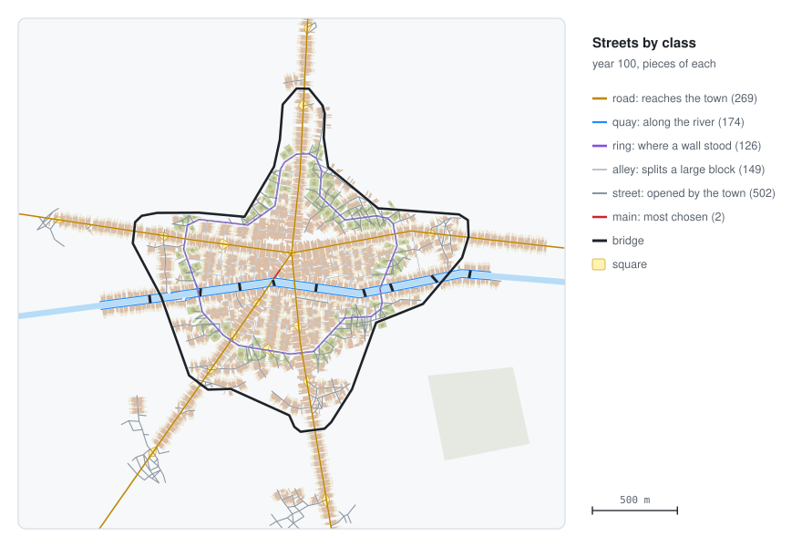
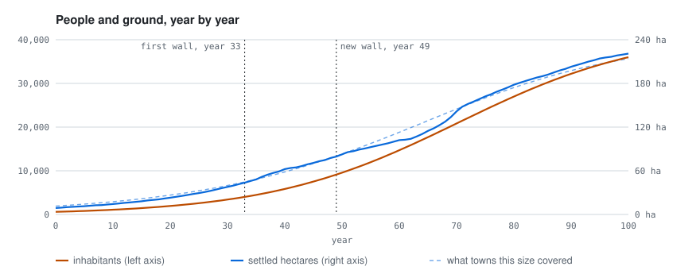

# 📤 Outputs

## Entities

The city appears as entities with ground shapes, one batch per kind, so thousands of houses stay
cheap to draw. Heights are in world units, exaggerated by `height_scale`. Properties travel with
them, so snapshots can be measured or drawn by other tools.

  

| Kind | Shape | Properties |
|---|---|---|
| `street` | line with a width | `class`: `road` (reaches the city from outside), `main` (most chosen, space syntax), `ring` (where an old wall stood), `street`, `alley`, `quay`; `from_node`, `to_node` |
| `parcel` | flat outline | `use`, `coverage`, `floors`, `year`, `front`, `depth`, `street`, `square_metres` |
| `building` | volume (floors × 3.2 m + 2 m) | `use`, `floors`, `parcel` |
| `wall` | line with a height | `year`, `current`, `height_m` |
| `old_wall` | flat line | `year` |
| `square` | flat outline | — |
| `bridge` | line | — |
| `river` | line with its width | `width` |

Uses: `housing`, `shop`, `workshop`, `extensive` (gardens and convents in the belts where old
walls stood) and `demolished` (taken by a new street, square or wall).

## The indicators event

In the years the `indicators` rule lists, an `indicators` event with the measures to compare with
historic town centres:

  

| Key | Measure |
|---|---|
| `year`, `inhabitants`, `parcels`, `street_pieces`, `walls` | counts |
| `settled_hectares` | ground of the parcels plus 40 % for streets and squares |
| `inhabitants_per_hectare` | density |
| `expected_hectares_cesaretti` | what a European city of this population covered around 1300 (Cesaretti et al. 2016) |
| `crossings_per_hectare`, `mean_street_piece_metres`, `edges_per_node`, `share_of_degree_three`, `share_of_dead_ends` | street network (Crucitti et al. 2006; Barthelemy and Flammini 2008) |
| `mean_block_metres` | blocks (Siksna 1997) |
| `mean_front_metres`, `mean_depth_metres` | plots (Conzen 1960) |
| `coverage_gsi`, `floor_area_ratio_far` | built coverage and floor area ratio |

Objectives in a rules file can read any of them, for example
`{event: indicators, value: inhabitants, near: 6000, tolerance: 0.05}`.
